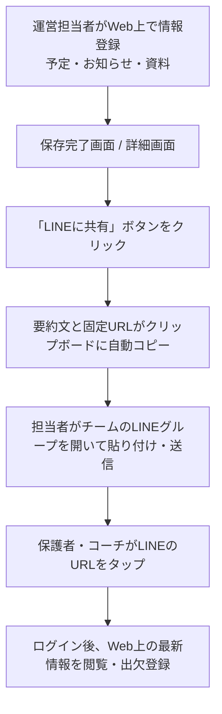

# 少年野球グループウェア 要件定義・基本設計書（Ver1.0確定版）

版：1.0 ／ 更新日：2026年10月15日 ／ ステータス：開発着手版

---

## 1. システム概要と開発背景

### 1.1 目的・コンセプト
本システムは、少年野球チームにおける**「今日、誰が、どこへ、何を持って行けばよいか」「誰が出席するのか」「チームの重要なお知らせや資料はどこにあるか」**を、ITスキルや年齢を問わず、スマートフォンから直感的に確認・操作できる運営基盤を構築することを目的とする。

従来のLINEを中心とした連絡運用で発生していた「重要連絡や共有資料がトークで流れてしまう」「日程変更後の最新版が分からなくなる」「誰が連絡を確認したか把握できない」という課題を、Webアプリケーションへの情報集約によって解決する。

### 1.2 課題と実現する仕組み
| 現状の課題 | Ver1.0での解決策 | 改善効果 |
|---|---|---|
| LINEのトーク内で重要な案内や資料が埋もれる | 予定・出欠・お知らせ・資料をWeb上に整理・保管する | 過去の連絡や提出物、規約類をいつでも即座に閲覧可能にする |
| 日程変更時にどれが最新情報か分からなくなる | 同一URLで常に最新情報を表示し、変更箇所を明示する | 古い情報の取り違えや集合時間・場所の勘違いを防止する |
| 誰が連絡を確認したか把握できない | 重要なお知らせに「確認しました」ボタンを設ける | 運営側が未確認の家庭を一覧で抽出し、個別フォローを可能にする |
| LINE Messaging APIの通数課金リスク | 自動配信を廃止し、Webからワンクリックで「LINE展開用テキスト」をコピーする運用にする | API利用料を完全0円に抑え、手動ペーストによる確実な連絡網を維持する |
| 年代ごとのITリテラシー差による操作迷子 | シニア層から若年層まで対応した徹底的なユニバーサルデザインを採用する | 「使い方が分からない」という問い合わせや操作ミスを撲滅する |

---

## 2. システム運用フロー（LINEコピペ共有モデル）

Messaging APIを用いたプッシュ通知は行わず、手動のクリップボード連携による安全かつコストゼロの運用を行う。



1. **登録・更新**: 運営担当者がWebアプリ上で「予定の登録」「お知らせの公開」「資料のアップロード」を行う。
2. **共有テキスト生成**: 画面上の「LINEに共有する」ボタンを押すと、件名・日時・会場・WebページのURLが整形されたテキストが端末のクリップボードに自動コピーされる。
3. **LINEグループへ展開**: 担当者が普段使っているLINEグループを開き、メッセージ入力欄にペーストして投稿する。
4. **会員のアクセス**: メッセージ内のURLをタップしてログインし、最新情報や添付資料を確認する。

---

## 3. アカウント・権限モデル

### 3.1 管理者集中型のアカウント管理
* **完全代理登録制**: 不正アクセスや部外者の登録を防ぐため、エンドユーザーによる「自己新規登録」機能は設けない。アカウントの新規作成、所属・背番号の設定、停止・削除はすべて管理者が管理画面から行う。
* **家庭モデル**: 1つの「家庭」レコードの下に、複数の保護者アカウントと複数の選手を紐づける。
* **個人別ログイン**: 家族共通のID/パスワードは使用せず、保護者一人ひとりが個別のログイン情報（ID/パスワード）を持つ。これにより、「どの保護者が確認したか」を正確にトラッキングする。
* **退団・卒団処理**: 選手が退団・卒団した際は、管理者が対象アカウントを「無効化」または「削除」することで、次回アクセスから即座にすべてのデータ閲覧を遮断する。

### 3.2 ロール（役割）と権限マトリクス
ユーザーには以下のロールを割り当て、兼任（例：保護者兼コーチ）にも対応する。

| 機能 / 操作 | システム管理者 | 運営（連絡担当） | コーチ | 保護者 |
|---|---|---|---|---|
| アカウントの作成・停止・削除・所属設定 | 可 | 不可 | 不可 | 不可 |
| 予定の登録・編集・中止設定 | 可 | 可 | 不可 | 不可 |
| 予定の閲覧 | 可 | 可 | 可 | 可 |
| 自家庭の選手の出欠登録・変更 | 兼任時のみ | 兼任時のみ | 兼任時のみ | 自家庭のみ |
| チーム全員の選手出欠一覧閲覧 | 可 | 可 | 可 | 可 |
| お知らせの作成・公開・編集 | 可 | 可 | 不可 | 不可 |
| お知らせの「確認しました」ボタン押下 | 兼任時のみ | 兼任時のみ | 可 | 可 |
| 未確認家庭一覧の確認・把握 | 可 | 可 | 不可 | 不可 |
| 資料のアップロード・権限設定 | 可 | 可 | 不可 | 不可 |
| 資料の閲覧・ダウンロード | 全資料 | 全資料 | 指定権限に準拠 | 指定権限に準拠 |
| LINE展開用テキストの生成・コピー | 可 | 可 | 不可 | 不可 |

---

## 4. 機能要件（Ver1.0 実装対象）

### F01. アカウント・家庭管理機能
* **管理者によるユーザー作成**: 管理者が保護者の氏名、メールアドレス、初期パスワードを発行・管理する。
* **家庭・選手紐付け**: 家庭単位で複数の保護者および複数の選手（兄弟対応）を登録する。選手ごとに学年、背番号、現時点の所属チーム（Aチーム・Bチーム等）を設定する。
* **アカウント無効化・削除**: 退団時や年度更新時に、対象ユーザーのアクセス権を即時に剥奪する。

### F02. 活動予定の管理・共有機能
* **予定の登録・編集**: 運営担当者が「対象チーム（複数選択可）」「開催日」「種別（練習・公式戦・練習試合・行事・その他）」「集合時刻・場所」「開始・終了時刻」「会場」「服装・持ち物」「雨天時等の補足」「開催状態（予定・変更・中止）」を入力・更新する。
* **予定一覧表示**:
  * 月別、および直近の土日祝日をまとめたカレンダー/リスト形式で表示する。
  * ログインユーザーの家庭に関係するチームの予定には「★（あなたに関係あり）」のバッジを表示する。
* **変更履歴と変更点の明示**: 集合時間や会場が変更された場合、「集合 08:00 → 08:30」のように変更箇所を予定カードの上部にハイライト表示する。
* **固定URL**: 予定ごとに一意の固定URLを発行し、LINE経由でいつ開いても常に最新版が表示されるようにする。

### F03. 選手の出欠登録・集計機能
* **独立出欠カレンダー**: 予定の登録有無にかかわらず、今日から2か月先までの全日付を対象に出欠登録が可能。
* **自家庭の回答登録**: 保護者は自家庭に紐づく選手について、日付ごとに「参加」「欠席」「未定」を選択して月単位で一括保存する。兄弟がいる場合は選手ごとに個別のステータスを設定可能。
* **全会員向け出欠一覧**: 日付およびチーム（A・B等）を指定することで、全保護者・コーチが「参加者一覧」「欠席者一覧」「未定・未回答者数」を確認できる。配車や合同練習の調整に活用する。
* **回答の保護**: 他家庭の選手の出欠を書き換えることはできない。

### F04. ブログ形式お知らせ機能
* **お知らせの作成・公開**: 件名、本文（整形テキスト）、分類、重要度（通常・重要・緊急）を設定して公開する。予定データと紐づけてリンクを埋め込むことも可能。
* **対象者の絞り込み**: 公開範囲を「全体」「Aチームのみ」「コーチのみ」等で指定可能。
* **既読・確認管理（「確認しました」ボタン）**:
  * 重要なお知らせには「確認しました」ボタンを設置する。
  * 同一家庭の保護者のうち1名がボタンを押せば「家庭として確認済み」と判定する。
  * 運営担当者は「未確認の家庭一覧」を画面上で確認し、連絡漏れを防ぐ。

### F05. 資料保管・閲覧権限制御機能
* **ファイルのアップロード保管**: チーム規約、当番表、配車表、グラウンド利用マニュアル（PDF、画像、Officeファイル等）を保管する。
* **柔軟なアクセス制御（認可）**: 資料ごとに以下のいずれかの公開範囲を管理者が指定する。
  1. **全体公開**: ログイン可能な全会員が閲覧可能。
  2. **ロール指定**: 「コーチ・スタッフのみ」「保護者のみ」など、特定の役割に限定して公開。
  3. **チーム指定**: 「Aチーム所属の家庭・指導者のみ」等に限定して公開。
  4. **特定ユーザー指定**: 「指導者Aさんと保護者Bさんのみ」など、個別のユーザーIDを指定して公開。
* **安全な配信**: クラウドストレージ上のファイルURLを直接外部公開せず、システム内でアクセス権限を照合した上でダウンロードを許可する。

### F06. LINE展開用テキスト生成機能
* **ワンクリックコピー**: 予定やお知らせの保存完了画面および詳細画面に「LINE共有テキストをコピー」ボタンを配置する。
* **生成フォーマット例**:
  ```text
  【予定登録】Aチーム 練習試合
  日時：10月24日(土) 集合 08:00 / 開始 09:00
  会場：〇〇市民球場
  持ち物：試合用ユニフォーム、お弁当、水筒
  
  ▼詳細の確認・出欠登録はこちら（要ログイン）
  https://example.com/events/1024
  ```

---

## 5. UI/UX 設計要件（ユニバーサルデザイン）

20代から60代以上のシニア層まで、あらゆる年代の保護者・指導者がストレスなく使えることを最優先とする。

### 5.1 モバイルファーストと視認性の確保
* **文字サイズと行間**: 本文フォントは最小でも16px相当を担保し、ピンチイン/アウト（画面拡大）を禁止しない設計とする。行間は1.5倍以上を確保する。
* **高コントラスト**: 白背景に対し、文字色は視認性の高いダークグレー（#222222等）を採用し、薄いグレー文字による見落としを防ぐ。
* **十分なタップ領域**: ボタン、リンク、カレンダーの日付セルのタップターゲットは、最低でも44px × 44px以上を確保し、誤操作を防ぐ。

### 5.2 認知負荷の低減とナビゲーション
* **下部固定ナビゲーション**: スマートフォン画面下部に「ホーム」「予定」「出欠」「お知らせ」「その他」のメニューを常時表示する。
* **アイコンとテキストの併記**: アイコン単体での表示を禁止し、必ず「予定」「出欠」など意味が明確な日本語ラベルを添える。
* **色だけに依存しない情報伝達**: 「中止」「要確認」などの重要な状態は、赤や黄色の文字・背景だけでなく、必ず「【中止】」「【要確認】」といったテキストバッジを併記する。

### 5.3 迷わせないフォームと安心設計
* **平易な言葉のエラー表示**: バリデーションエラー時は「無効なパラメータです」等のシステム用語を使わず、「集合時刻を開始時刻より前の時間で入力してください」のように、どこをどう直せばよいかを具体的に表示する。
* **二重送信防止**: 送信ボタンを押した直後にボタンを非活性化（disabled）にし、「保存中...」と明示して連打による二重投稿を防ぐ。

---

## 6. セキュリティ・非機能要件

子どもたちの個人情報および活動拠点を安全に保護するため、Web標準のセキュリティを徹底する。

### 6.1 認証・認可とアクセス制御
* **完全クローズド環境**: 認証されていない未ログインユーザーは、ログイン画面以外のすべてのページおよびAPIへのアクセスを拒否する。
* **サーバーサイド認可検証**: 画面上のボタン非表示だけでなく、APIリクエスト受信時に対象データの権限（ロール、家庭紐付け、資料の閲覧許可設定）をサーバー側で厳格に再検証する。URLの直打ち（推測）による不正アクセスを防止する。
* **個人情報の保護**: 出欠表等で選手の氏名や学年は全会員に表示されるが、保護者の電話番号やメールアドレス等の連絡先情報は、管理者以外には非公開とする。

### 6.2 脆弱性対策と通信保護
* **通信の暗号化**: 全画面および全API通信において常時SSL/TLS（HTTPS）を必須とする。
* **XSS（クロスサイトスクリプティング）対策**: ユーザーが入力した文字列はすべてエスケープ処理を施し、悪意あるスクリプトの実行を防止する。
* **CSRF（クロスサイトリクエストフォージェリ）対策**: データの更新・削除を伴う全POST/PUT/DELETEリクエストにCSRFトークンの検証を適用する。
* **パスワードの安全な保存**: パスワードは平文で保存せず、Argon2またはbcryptによる強固なハッシュ化を行って保存する。

### 6.3 ファイルストレージセキュリティ
* **非公開バケット**: クラウドストレージ（AWS S3等）はパブリックアクセスを完全遮断する。
* **認可経由のファイル取得**: ファイルダウンロード時は、APIがユーザーの閲覧権限を確認した上で、短時間（例：5分間）のみ有効な署名付きURL（Pre-signed URL）を発行するか、APIストリーム経由で安全に返却する。

### 6.4 バックアップと耐障害性
* **データバックアップ**: データベースの自動日次バックアップを実施し、最低30日間保持する。
* **障害復旧**: システム障害時のデータ復旧手順を整備し、前日時点のバックアップから速やかに復旧できる体制を整える。

---

## 7. 画面一覧（Ver1.0）

| 画面ID | 画面名 | 対象ロール | 主な要素・操作 |
|---|---|---|---|
| S01 | ログイン画面 | 全員 | ID/パスワード入力、ログイン維持チェックボックス |
| S02 | ホーム画面 | 全員 | 次の活動予定、重要なお知らせ、最近の更新フィード |
| S03 | 予定一覧・詳細画面 | 全員 | 土日祝の予定カード表示、★マーク表示、LINE共有テキストコピーボタン |
| S04 | 予定登録・編集画面 | 管理者・運営 | 予定情報入力フォーム、中止・変更フラグ切り替え |
| S05 | 出欠登録画面（自家庭） | 全員（保護者） | 2か月先までのカレンダー、選手別ステータス切り替え、一括保存 |
| S06 | 出欠一覧画面（チーム） | 全員 | 日付選択、チーム別（A・B等）参加・欠席者リストおよび人数集計 |
| S07 | お知らせ一覧・詳細画面 | 全員 | 記事本文、「確認しました」ボタン、未確認家庭リスト（運営のみ） |
| S08 | お知らせ作成・編集画面 | 管理者・運営 | 投稿フォーム、公開対象選択、LINE共有テキストコピーボタン |
| S09 | 資料一覧・保管画面 | 全員 | カテゴリ別ファイルリスト、閲覧権限に基づくフィルタ表示 |
| S10 | 資料アップロード画面 | 管理者・運営 | ファイル選択、公開範囲指定（全体/ロール/チーム/特定ユーザー） |
| S11 | アカウント管理画面 | 管理者 | ユーザー作成・編集・削除、家庭・選手紐付け、ロール付与 |

---

## 8. Ver2以降の検討候補（初期スコープ外）

開発スピードを優先し、初期版の安定稼働を確認した後に以下の機能を段階的に追加検討する。

* **試合速報・スコアブック機能**: イニング別得点、現況コメント、試合結果のアーカイブ管理。
* **コーチ出欠管理機能**: 保護者出欠とは独立した、指導者専用の出欠登録・閲覧機能。
* **話題別コメント・質問機能**: 予定やお知らせに紐づく質疑応答スレッド。
* **写真・動画アルバム機能**: 大会や合宿の写真共有機能。
* **配車・当番自動割り当て機能**: 出欠データと連動した配車・審判当番のスケジューリング機能。
